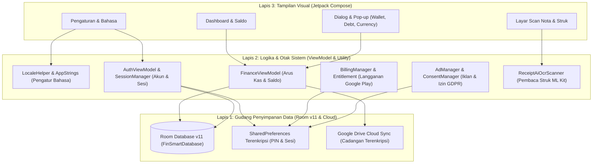

# ARCHITECTURE_MAP.md
# PETA ARSITEKTUR & PANDUAN ANTI-TABRAKAN MODUL: DOMPETNALAR (FINSMART)

> [!IMPORTANT]
> **PANDUAN MUTLAK OWNER & AGEN (NON-CODER FRIENDLY):**
> Dokumen ini adalah peta navigasi proyek agar AI mana pun yang bekerja **TIDAK MERUSAK** fitur yang sudah berjalan dengan normal.
> Setiap modul dibagi menjadi dua zona: **Zona Merah (Kritis - Dilarang Sembarangan Disentuh)** dan **Zona Hijau (Aman untuk Perbaikan/Pengembangan)**.

---

## 1. 🗺️ Diagram Alur Sistem DompetNalar

---

## 2. 🛡️ Zona Modul Kritis (🔴 DILARANG KERAS DIRUSAK)

Modul-modul ini adalah fondasi inti aplikasi yang telah teruji dan beroperasi normal. Perubahan ceroboh pada modul ini dapat mengakibatkan hilangnya data pengguna atau penolakan di Google Play Store.

| Modul / Berkas | Fungsi Utama | Risiko Jika Dirontokkan | Aturan Pengamanan |
| :--- | :--- | :--- | :--- |
| **`FinSmartDatabase.kt` & DAO** | Gudang data SQLite (Room v11) berisi akun, transaksi, dompet, hutang, dan aset. | **FATAL:** Data uang pengguna terhapus, migrasi gagal, aplikasi tidak bisa dibuka (*crash loop*). | Dilarang mengubah skema tabel tanpa membuat berkas `MigrationXToY.kt` resmi dan lulus tes migrasi Room. |
| **`BillingManager.kt` & `EntitlementManager.kt`** | Integrasi Google Play Billing untuk pembelian lisensi *Smart Master*. | **TINGGI:** Pengguna berbayar kehilangan akses premium, pelanggaran kebijakan Google Play. | Dilarang merombak alur pembelian produk dan validasi lisensi offline/online. |
| **`SessionManager.kt` & DAO Isolation** | Pengunci data antar pengguna (mode tamu vs akun login terdaftar). | **TINGGI:** Kebocoran data keuangan pribadi antar akun di perangkat yang sama. | Dilarang menghapus parameter `userId` pada kueri database. |
| **`AdManager.kt` & `ConsentManager.kt`** | Penayangan iklan AdMob dan pengumpulan persetujuan privasi GDPR (UMP). | **SEDANG:** Akun AdMob dibekukan karena pelanggaran privasi. | Menjaga batas waktu 60 menit reward iklan mode tamu dan bebas iklan bagi Smart Master. |
| **`PayLaterAiOcrScanner.kt` & `ReceiptAiOcrScanner.kt`** | Ekstraksi teks struk belanja dan tagihan via kamera dengan ML Kit. | **SEDANG:** Kesalahan deteksi nominal dan tanggal belanja. | Logika matematika parser angka dan tanggal wajib diverifikasi dengan unit test. |

---

## 3. 🛠️ Zona Perbaikan Aktif (🟢 AMAN UNTUK DIPERBAIKI)

Modul-modul ini adalah target kerja utama saat ini untuk menyelesaikan masalah yang dilaporkan Owner:

| Target Masalah | Berkas Terkait | Rencana Perbaikan Aman |
| :--- | :--- | :--- |
| **Bug Crash Pergantian Bahasa** | `LocaleHelper.kt`, `MainActivity.kt` | Menyelaraskan pergantian bahasa ke standar resmi Android 14 (`LocaleManager`) dan menghapus pembungkus konteks buatan (`createConfigurationContext`) di `attachBaseContext` yang merusak *Window Token*. |
| **Teks Campur-Campur (Dwibahasa)** | `SettingsScreen.kt`, `AppStrings.kt`, `strings.xml`, seluruh Dialog | Mengganti seluruh teks berbahasa Indonesia yang muncul di mode Inggris dengan `AppStrings.t()`, dan mengindonesiakan istilah mentah di mode Indonesia. |
| **Penggantian Nama Lama FinSmart -> DompetNalar** | Tampilan UI, judul dialog, header merek, badge gamifikasi | Mengganti string merek visual dari `FinSmart` menjadi `DompetNalar` (tanpa mengubah nama paket teknis `com.aistudio.finsmart`). |
| **Responsivitas UI & Bug Vertikal** | Seluruh `AlertDialog`, `ModalBottomSheet`, `FinSmartApp.kt` | Menambahkan `Modifier.verticalScroll` agar konten tidak terpotong pada layar kecil/font besar, serta menambahkan transisi animasi halus antar tab menu. |

---

## 4. 📌 Konvensi & Pola Baku Kode Proyek
1. **Bahasa Tampilan Dinamis:** Seluruh teks antarmuka wajib memakai `AppStrings.t("Teks Indonesia", "English Text")`. Dilarang menuliskan teks mentah tanpa seleksi bahasa.
2. **Kemandirian Komponen:** Komponen dialog dan kartu tidak boleh memblokir thread UI.
3. **Format Mata Uang:** Wajib melalui `CurrencyFormatter.formatCurrency()` agar konsisten dengan mata uang global yang dipilih pengguna.
