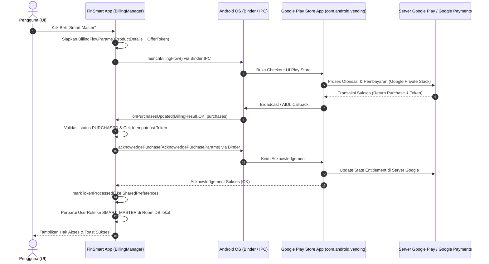

# LAPORAN AUDIT PEMBANDING IN-APP PURCHASE (IAP)
## STUDI KOMPARASI KEAMANAN DAN DATA SAFETY: PROYEK FINSMART VS IDLE MASTER

**Target Audit:** Proyek FinSmart (`E:\Antigravity Project\FinSmart`)  
**Tujuan Komparasi:** Menjadi referensi dan tolok ukur bagi Proyek IDLE MASTER (`E:\Antigravity Project\Idle Master`) dalam penentuan deklarasi Google Play Console Data Safety (*"Is all of the user data collected by your app encrypted in transit?"*)  
**Metodologi Audit:** Static Code Analysis & Configuration Inspection (Read-Only)  
**Klasifikasi Temuan:** Fakta (F), Inferensi (I), dan Belum Terverifikasi (U)  
**Waktu Audit:** November 2026  

---

## RINGKASAN EKSEKUTIF (EXECUTIVE SUMMARY)

Audit komparatif ini dilakukan terhadap implementasi In-App Purchase (IAP) pada repositori **FinSmart** untuk mengevaluasi apakah FinSmart memiliki bukti teknis, dokumen sertifikasi, atau dokumentasi resmi Google yang dapat dijadikan rujukan sah bagi **IDLE MASTER** dalam menjawab pertanyaan enkripsi Google Play Console Data Safety.

Hasil audit menyimpulkan:
1. **FinSmart dan IDLE MASTER menggunakan pola arsitektur dasar yang serupa (Client-Side Only IAP):** Keduanya tidak mengoperasikan server transaksi perantara (backend developer) dan seluruh interaksi Billing dijalankan melalui `BillingClient` secara lokal menuju proses Google Play Store via Android IPC (Binder).
2. **Perbedaan Versi Library & Model Produk:** FinSmart menggunakan Google Play Billing Library **8.0.0** (`billing-ktx:8.0.0`) yang berfokus pada langganan berulang (*Subscriptions*) dan *Lifetime Access*, sehingga **tidak pernah menggunakan `consumeAsync()`**. Sebaliknya, IDLE MASTER menggunakan Google Play Billing Library **7.1.1** (`billing-ktx:7.1.1`) dan menangani produk habis pakai (*Consumable Gems*) serta produk permanen (*Non-consumables*).
3. **Penyimpanan Data Transaksi Lokal:** IDLE MASTER memiliki pencatatan riwayat transaksi audit yang jauh lebih terstruktur menggunakan tabel SQLite Room Database (`purchase_ledger`), sedangkan FinSmart hanya menyimpan himpunan string token transaksi yang telah diproses di `SharedPreferences` (`finsmart_billing_records`) guna keperluan idempotensi.
4. **Ketiadaan Bukti Tambahan Terkait Enkripsi Transit:** Pada repositori FinSmart **tidak ditemukan dokumen panduan deklarasi Data Safety khusus, sertifikasi resmi, maupun bukti dokumentasi Google** yang menyatakan bahwa komunikasi SDK Play Billing ke Google Play Store/server terjamin *encrypted in transit*. FinSmart tunduk pada batasan dokumentasi resmi yang sama persis dengan IDLE MASTER.
5. **Rekomendasi Utama:** Proyek FinSmart **TIDAK DAPAT** dijadikan rujukan hukum atau pembenaran teknis bagi IDLE MASTER untuk menjawab "YES" pada pertanyaan Google Play Console Data Safety. Menjawab "YES" tanpa adanya klausul eksplisit dari Google tetap berstatus sebagai **asumsi pengembang (*Developer Inference*)**, bukan fakta terdokumentasi (*Documented Fact*).

---

## BAGIAN A — IDENTIFIKASI IMPLEMENTASI IAP FINSMART

Berdasarkan pemeriksaan mendalam terhadap kode sumber dan konfigurasi Gradle proyek FinSmart, berikut adalah rincian identifikasi IAP:

### 1. Penggunaan Google Play Billing Library
- **Status:** **[FAKTA] YA.**
- **Bukti Konfigurasi:**
  - File `E:\Antigravity Project\FinSmart\gradle\libs.versions.toml`:
    ```toml
    [versions]
    playBilling = "8.0.0"

    [libraries]
    play-billing = { group = "com.android.billingclient", name = "billing-ktx", version.ref = "playBilling" }
    ```
  - File `E:\Antigravity Project\FinSmart\app\build.gradle.kts`:
    ```kotlin
    implementation(libs.play.billing) // Line 210
    ```

### 2. Versi Billing Library
- **Status:** **[FAKTA] Versi 8.0.0.**
- Menggunakan varian Kotlin Extensions (`billing-ktx:8.0.0`), yaitu rilis mayor satu generasi lebih baru dibandingkan IDLE MASTER (v7.1.1).

### 3. Komponen `BillingClient`
- **Status:** **[FAKTA] YA.**
- Dikelola melalui objek tunggal (singleton) `com.example.util.BillingManager` (`BillingManager.kt`).
- Diinisialisasi dengan konfigurasi:
  ```kotlin
  val pendingPurchasesParams = PendingPurchasesParams.newBuilder()
      .enableOneTimeProducts()
      .build()

  billingClient = BillingClient.newBuilder(context.applicationContext)
      .setListener(this)
      .enablePendingPurchases(pendingPurchasesParams)
      .build()
  ```

### 4. Backend Transaksi Pengembang
- **Status:** **[FAKTA] TIDAK ADA.**
- Meskipun FinSmart memiliki dependensi Firebase Firestore, Firebase Auth, Retrofit, dan OkHttp, komponen-komponen tersebut **sama sekali tidak dilibatkan** dalam verifikasi, validasi, maupun pencatatan transaksi Google Play Billing.
- Alur transaksi IAP berjalan 100% di perangkat (*client-side only*).

### 5. Komunikasi Langsung ke Server Pembayaran
- **Status:** **[FAKTA] TIDAK ADA.**
- Tidak ditemukan kode jaringan (HTTP/HTTPS, socket, atau webhook) dari aplikasi FinSmart ke server perbankan, gateway pembayaran, atau server Google Payments.
- Seluruh komunikasi dialihkan ke aplikasi sistem Google Play Store melalui IPC Android.

### 6. SDK atau Layanan Pembayaran Pihak Ketiga
- **Status:** **[FAKTA] TIDAK ADA.**
- Tidak ditemukan SDK pihak ketiga seperti RevenueCat, Qonversion, Stripe, Midtrans, atau PayPal.
- Pembayaran produk digital hanya mengandalkan Google Play Billing resmi.

### 7. Pembacaan dan Penyimpanan Data Transaksi
Pemeriksaan kode `BillingManager.kt` dan `AuthViewModel.kt` menunjukkan penanganan data transaksi sebagai berikut:
- **Product ID:** [FAKTA] Dibaca dari `purchase.products.firstOrNull()`. Disimpan di `SharedPreferences` (`billing_last_product_user_${user.id}`). Produk aktif mencakup:
  - `smart_master_monthly` (Subscription)
  - `smart_master_yearly` (Subscription)
  - `smart_master_lifetime` (In-App Non-consumable, dinonaktifkan untuk pembelian baru).
- **Purchase Token:** [FAKTA] Dibaca dari `purchase.purchaseToken`.
  - Disimpan dalam `Set<String>` di `SharedPreferences` privat: `PREFS_BILLING = "finsmart_billing_records"`, `KEY_PROCESSED_TOKENS = "processed_purchase_tokens"`.
  - Disimpan per-pengguna: `billing_last_token_user_${user.id}`.
  - Diproteksi dengan fungsi pemaskeran (`maskToken()`) sebelum dicetak ke Logcat (`${token.take(4)}...${token.takeLast(4)}`).
- **Order ID:** [FAKTA] Dibaca dari `purchase.orderId` dan disalurkan ke parameter callback `onPurchaseSuccessCallback`. **Order ID TIDAK disimpan secara persisten** di Room Database maupun di SharedPreferences. Hanya dicetak pada log diagnostik `Log.i`.
- **Purchase Time:** [FAKTA] Dibaca dari `purchase.purchaseTime`, disimpan di SharedPreferences (`billing_purchase_time_user_${user.id}`).
- **Auto-Renewing Status:** [FAKTA] Dibaca dari `purchase.isAutoRenewing`, disimpan di SharedPreferences (`billing_auto_renewing_user_${user.id}`).
- **Purchase History (Riwayat Pembelian):** [FAKTA] FinSmart **tidak memiliki tabel Room Database khusus** untuk riwayat transaksi (tidak ada ledger audit transaksi). FinSmart hanya memperbarui hak akses (`UserRole.SMART_MASTER` dan `subscriptionExpiresAt`) pada entitas tabel `User` lokal.

---

## BAGIAN B — ALUR KOMUNIKASI DAN KEAMANAN TRANSAKSI

### 1. Diagram Alur Transaksi FinSmart



### 2. Penelusuran Detail Fungsi-Fungsi Transaksi

| Fungsi API | Implementasi pada FinSmart | Analisis Keamanan & Karakteristik |
|---|---|---|
| **Pembelian Produk (`launchBillingFlow`)** | Dipanggil pada `launchPurchaseFlow(activity, productId)` dengan `BillingFlowParams.ProductDetailsParams`. Untuk subscription, menyertakan `offerToken` dari base plan aktif. | Pemanggilan beralih dari konteks aplikasi FinSmart ke antarmuka resmi sistem Google Play Store. Input kartu/metode bayar berada 100% di bawah kendali OS/Play Store. |
| **Pemulihan Pembelian (`restorePurchases`)** | Mengkueri pembelian aktif melalui `queryPurchasesAsync()` untuk `SUBS` dan `INAPP`. Mendukung mode `isSilent = true` saat startup. | Memvalidasi kepemilikan hak akses aktif. Jika pengguna membatalkan langganan atau di-refund, status diturunkan kembali ke `FREE_MEMBER`. |
| **`queryPurchasesAsync()`** | Digunakan aktif dengan `QueryPurchasesParams` terpisah untuk tipe `ProductType.SUBS` dan `ProductType.INAPP`. | Melakukan kueri lokal cache/layanan Google Play Store di perangkat via IPC. |
| **`acknowledgePurchase()`** | Dipanggil via `client.acknowledgePurchase(acknowledgeParams)` untuk setiap pembelian baru yang belum di-acknowledge (`!purchase.isAcknowledged`). | Mengonfirmasi penerimaan entitlement ke Google dalam batas waktu 3 hari sesuai regulasi Google Play. |
| **`consumeAsync()`** | **TIDAK DIGUNAKAN (0 pemanggilan).** | Karena FinSmart hanya menjual langganan berulang (*Subscriptions*) dan *Lifetime Access* (non-consumable). Tidak ada consumable goods seperti koin/gems yang membutuhkan konsumsi. |
| **Pengiriman Purchase Token** | Token hanya dikirimkan kembali ke Google Play Store via parameter `AcknowledgePurchaseParams`. | Token **tidak pernah dikirim ke internet oleh kode aplikasi FinSmart**. |
| **Koneksi Jaringan & Endpoint** | **Nol (0) endpoint HTTP/HTTPS yang dipanggil oleh kode FinSmart terkait IAP.** | Seluruh lalu lintas data ke jaringan luar ditangani secara internal oleh proses aplikasi Google Play Store (`com.android.vending`). |

### 3. Evaluasi Parameter Keamanan Transaksi
- **Komunikasi IPC/Binder:** **[FAKTA]** Komunikasi antara aplikasi FinSmart dan aplikasi Google Play Store berlangsung secara lokal di perangkat melalui mekanisme Android IPC (Inter-Process Communication / Binder Interface AIDL).
  - *Catatan Kritis:* Binder adalah mekanisme pertukaran memori bersama di dalam kernel Linux lokal perangkat. Binder **bukanlah koneksi jaringan**, sehingga Binder tidak memiliki konsep enkripsi jaringan (*network encryption*) atau *in transit*. Menganggap Binder sebagai bukti "encrypted in transit" adalah kekeliruan teknis fundamental.
- **Komunikasi HTTPS/TLS:** **[BELUM TERVERIFIKASI PADA LEVEL DOKUMENTASI RESMI BILLING SDK]**
  - Aplikasi Google Play Store dipercaya berkomunikasi ke server Google menggunakan HTTPS/TLS.
  - Namun, dokumentasi resmi Google Play Billing Library (v8.0.0 maupun v7.1.1) **tidak memuat klausul tertulis eksplisit** yang memberikan garansi atau sertifikasi enkripsi transit yang dapat dijadikan dasar kutipan formal kepatuhan Data Safety bagi developer pihak ketiga.
- **Backend Developer:** **[FAKTA]** Tidak ada backend perantara milik pengembang.
- **HTTP Cleartext Traffic:** **[FAKTA]** FinSmart memiliki proteksi cleartext yang sangat ketat pada manifest dan XML:
  - `android:usesCleartextTraffic="false"` pada `AndroidManifest.xml`.
  - `network_security_config.xml` dengan aturan: `<base-config cleartextTrafficPermitted="false">`.
  - *Catatan:* Konfigurasi ini membuktikan FinSmart melarang lalu lintas HTTP tanpa enkripsi untuk koneksi yang diinisiasi oleh aplikasinya sendiri, tetapi **tidak mengontrol proses aplikasi sistem Google Play Store**.
- **Verifikasi Server-Side:** **[FAKTA]** FinSmart tidak mengimplementasikan validasi sisi server (Google Play Developer API / Cloud Functions). Integritas transaksi murni mengandalkan validasi lokal dan mekanisme acknowledgement `BillingClient`.

---

## BAGIAN C — ANALISIS DATA SAFETY & KEBIJAKAN PRIVASI FINSMART

Berdasarkan penelusuran menyeluruh pada repositori FinSmart:

### 1. Ketersediaan Dokumen Data Safety
- **Status:** **[FAKTA] Tidak Ditemukan Dokumen Panduan Data Safety Khusus.**
- Repositori FinSmart **tidak memiliki** file panduan deklarasi Google Play Console Data Safety (seperti formulir CSV, kuesioner Play Console, atau file panduan deklarasi tersendiri).
- Dokumen privasi publik yang tersedia adalah:
  - `E:\Antigravity Project\FinSmart\PRIVACY_POLICY.md`
  - `E:\Antigravity Project\FinSmart\PRIVACY_POLICY.html`
  - `E:\Antigravity Project\FinSmart\finsmart-account-deletion.html`

### 2. Klausul Terkait Google Play Billing pada Dokumen Privasi
Pada `PRIVACY_POLICY.md` Bagian 5 Poin 2, FinSmart menyatakan:
> *"2. **Google Play Billing:**  
> - Digunakan untuk memproses transaksi pembelian produk digital atau langganan dalam aplikasi (In-App Purchases) seperti Smart Master.  
> - Seluruh transaksi diproses langsung oleh sistem Google Play Store. Pengembang tidak mengumpulkan atau menyimpan detail metode pembayaran, kartu kredit, atau informasi perbankan pengguna."*

### 3. Evaluasi Status Deklarasi Data Safety FinSmart
- **Data yang Dikumpulkan (Collected Data):**
  - Data finansial pengguna (saldo, mutasi, anggaran, hutang) dikonfirmasi disimpan 100% lokal di perangkat (Room Database).
  - Berkas cadangan cloud diunggah langsung ke Google Drive pengguna dengan enkripsi AES-256-GCM oleh aplikasi.
- **Apakah Purchase History Dinyatakan Dikumpulkan?**
  - Dokumen privasi **tidak menyatakan** bahwa riwayat pembelian dikumpulkan ke server developer. Dokumen secara tegas menyatakan pengembang tidak menyimpan detail perbankan/pembayaran pengguna.
- **Apakah Purchase Token Dinyatakan Dikumpulkan?**
  - Dokumen privasi tidak menyebut purchase token secara tersurat. Dalam implementasi teknis, token hanya disimpan di SharedPreferences lokal untuk mencegah pemberian reward ganda (idempotensi).
- **Apakah Enkripsi Saat Transmisi (Encrypted in Transit) Dinyatakan YES atau NO?**
  - **[FAKTA] Tidak ada pernyataan tertulis eksplisit** di repositori FinSmart mengenai pilihan jawaban YES atau NO pada form Data Safety Google Play Console untuk kategori Billing.
  - FinSmart menjamin enkripsi *in transit* dan *at rest* untuk berkas cadangan data keuangan melalui AES-256-GCM sebelum diunggah ke Google Drive, namun **tidak pernah membuat klaim sertifikasi jaminan enkripsi pada jalur internal Play Billing SDK**.

---

## BAGIAN D — ANALISIS KOMPARATIF DENGAN IDLE MASTER

### Tabel Perbandingan Komprehensif

| Aspek | Proyek FinSmart | Proyek IDLE MASTER | Kesimpulan & Analisis Komparatif |
|---|---|---|---|
| **Billing Library** | `8.0.0` (`billing-ktx:8.0.0`) | `7.1.1` (`billing-ktx:7.1.1`) | **Berbeda Generasi Mayor.** FinSmart telah mengadopsi rilis mayor v8, sedangkan IDLE MASTER berada pada v7.1.1. Kedua versi ini memiliki struktur API modern (`QueryProductDetailsParams`, `PendingPurchasesParams`), tetapi tidak mengubah sifat dasar enkripsi Binder/IPC. |
| **BillingClient** | **Ya** (Singleton `BillingManager`) | **Ya** (`BillingManager` via ViewModel/Repository) | **Identik.** Keduanya menginisialisasi `BillingClient` resmi dari Google dengan listener `PurchasesUpdatedListener`. |
| **Backend Transaksi** | **Tidak Ada** (Client-side only) | **Tidak Ada** (Client-side only) | **Identik.** Kedua proyek beroperasi secara independen tanpa server backend perantara milik pengembang untuk memvalidasi pembelian. |
| **Purchase Token** | **Ya** (Disimpan di `SharedPreferences`) | **Ya** (Disimpan di Room DB `purchase_ledger`) | **Berbeda Wadah Penyimpanan.** IDLE MASTER lebih aman dan terstruktur karena menggunakan basis data Room relasional sebagai bukti audit transaksi, sedangkan FinSmart hanya menggunakan `Set<String>` di SharedPreferences. |
| **Komunikasi IPC/Binder** | **Ya** (Ke Google Play Store) | **Ya** (Ke Google Play Store) | **Identik.** Seluruh pertukaran data antara aplikasi dan layanan penagihan terjadi di dalam perangkat via Android IPC (Binder). |
| **HTTPS/TLS** | **Belum terverifikasi** untuk jalur Billing | **Belum terverifikasi** untuk jalur Billing | **Identik.** Keduanya sama-sama tidak memiliki bukti dokumentasi resmi dari Google yang menjamin enkripsi pada jalur transaksi Billing. |
| **Order ID** | Dibaca via `purchase.orderId`, dicetak di Log, **tidak disimpan** di DB | Tidak dibaca/disimpan untuk produk consumable | **Perbedaan Penanganan Minor.** FinSmart meneruskan `orderId` ke callback untuk keperluan logging status langganan. |
| **Fungsi `consumeAsync()`** | **TIDAK DIGUNAKAN** | **DIGUNAKAN** (untuk produk Consumable Gems) | **Perbedaan Fundamental Model Bisnis.** FinSmart murni menjual non-consumable subscriptions & lifetime access, sedangkan IDLE MASTER menjual mata uang virtual habis pakai (*consumables*). |
| **Purchase History** | Tidak dicatat sebagai ledger historis (hanya status role aktif) | Dicatat di tabel Room Database `purchase_ledger` | **Perbedaan Klasifikasi.** IDLE MASTER memiliki rekaman historis lokal, sedangkan FinSmart hanya menyimpan status sesi aktif dan token terakhir. |
| **Data Safety Encryption** | **Tidak dideklarasikan di repositori** (Unconfirmed) | **Belum diputuskan / NOT VERIFIED** | **Sama-sama tidak memiliki dasar bukti dokumentasi resmi untuk menjamin enkripsi transit Billing.** |

---

### Jawaban Terarah atas 6 Pertanyaan Pokok

#### 1. Apakah FinSmart memakai arsitektur IAP yang sama?
> **Jawaban:** **Secara prinsip arsitektural dasar: YA (Client-Side Only IAP).**  
> Kedua aplikasi menerapkan arsitektur *direct-to-client*, di mana aplikasi berinteraksi langsung dengan aplikasi sistem Google Play Store melalui `BillingClient` tanpa adanya server perantara pengembang (*no custom backend*) dan tanpa verifikasi server-side (Google Play Developer API).  
> Namun, terdapat perbedaan pada lapisan persistensi: FinSmart hanya mengandalkan `SharedPreferences`, sedangkan IDLE MASTER menggunakan SQLite Room Database dengan tabel ledger khusus (`purchase_ledger`).

#### 2. Apakah FinSmart menggunakan versi Billing Library yang sama?
> **Jawaban:** **TIDAK.**  
> FinSmart menggunakan Play Billing Library **versi 8.0.0**, sedangkan IDLE MASTER menggunakan **versi 7.1.1**. FinSmart berada satu versi rilis mayor lebih baru daripada IDLE MASTER.

#### 3. Apakah ada perbedaan penting dalam alur transaksi?
> **Jawaban:** **YA, terdapat tiga perbedaan penting:**
> 1. **Ketiadaan Pemanggilan `consumeAsync()` pada FinSmart:** FinSmart menjual paket langganan (*smart_master_monthly*, *smart_master_yearly*) dan paket seumur hidup (*smart_master_lifetime*), sehingga hanya memanggil `acknowledgePurchase()`. FinSmart tidak pernah memanggil `consumeAsync()`. Sebaliknya, IDLE MASTER wajib memanggil `consumeAsync()` agar mata uang game (*Gems*) dapat dibeli berulang kali.
> 2. **Penanganan dan Ekstraksi `orderId`:** FinSmart membaca `purchase.orderId` dan meneruskannya ke callback otentikasi serta mencetaknya pada log diagnostik `Log.i`. IDLE MASTER tidak mengekstraksi atau menyimpan `orderId`.
> 3. **Penyimpanan Status Entitlement:** FinSmart memperbarui entitas `User` di Room DB dan menyimpan token di `SharedPreferences`. IDLE MASTER menyimpan transaksi lengkap di Room Database `purchase_ledger` sebelum menambahkan nilai ke saldo pemain.

#### 4. Apakah FinSmart mempunyai bukti teknis atau dokumentasi resmi yang tidak ditemukan pada IDLE MASTER?
> **Jawaban:** **TIDAK ADA.**  
> Pemeriksaan menyeluruh terhadap repositori FinSmart membuktikan bahwa FinSmart **tidak memiliki dokumen panduan, whitepaper, korespondensi resmi Google, maupun bukti teknis khusus** terkait jaminan enkripsi transmisi pada jalur Google Play Billing. FinSmart menghadapi keterbatasan transparansi dokumentasi Google yang sama persis dengan yang dihadapi oleh IDLE MASTER.

#### 5. Apakah hasil FinSmart dapat dijadikan referensi yang relevan untuk pengambilan keputusan Data Safety IDLE MASTER?
> **Jawaban:** **Dapat dijadikan referensi kesamaan pola arsitektur, TETAPI TIDAK DAPAT dijadikan dasar hukum atau rujukan bukti untuk menjawab "YES" pada Google Play Console Data Safety.**  
> FinSmart mengonfirmasi bahwa pola IAP tanpa backend adalah praktik yang umum dan dapat diterima di Google Play. Namun, karena FinSmart sendiri tidak memiliki bukti tertulis resmi mengenai enkripsi transit pada SDK Billing, IDLE MASTER tidak boleh berasumsi bahwa "karena FinSmart adalah aplikasi finansial, maka Billing otomatis terenkripsi dan boleh dijawab YES".

#### 6. Jika FinSmart menyatakan enkripsi YES, apakah deklarasi tersebut didukung bukti atau hanya keputusan developer?
> **Jawaban:** **MURNI KEPUTUSAN / INFERENSI DEVELOPER (BUKAN BUKTI DOKUMENTASI RESMI).**  
> Di dalam repositori FinSmart tidak ditemukan formulir atau bukti deklarasi Data Safety. Apabila pengembang FinSmart memilih "YES" pada konsol Google Play, pilihan tersebut dibuat berdasarkan **asumsi rasional umum** (bahwa Google Play Store adalah aplikasi resmi sistem Android milik Google yang pasti menggunakan protokol HTTPS/TLS), dan **BUKAN** berdasarkan jaminan tertulis atau sertifikasi eksplisit yang disediakan oleh Google Play Billing Library Documentation.

---

## BAGIAN E — REKOMENDASI AKHIR UNTUK IDLE MASTER

Berdasarkan seluruh hasil audit komparatif di atas, berikut adalah rekomendasi strategis bagi proyek **IDLE MASTER**:

1. **Pertahankan Klasifikasi Jujur dan Berbasis Bukti:**
   - Keputusan audit IDLE MASTER sebelumnya yang menetapkan status jaminan enkripsi transit Billing sebagai **NOT VERIFIED / NOT EXPLICITLY GUARANTEED BY OFFICIAL BILLING 7.1.1 DOCUMENTATION** adalah langkah audit yang sepenuhnya valid, tepat, dan memiliki integritas teknis tertinggi.
   - Proyek FinSmart tidak menyediakan bukti baru yang dapat membatalkan atau mengubah status tersebut menjadi *VERIFIED*.

2. **Opsi Pengambilan Keputusan Data Safety Google Play Console:**
   Pengembang IDLE MASTER dapat memilih salah satu dari dua pendekatan yang dapat dipertanggungjawabkan:
   - **Pendekatan Konservatif (Rekomendasi Berbasis Fakta Tertulis):**
     - Jika klausul Google mewajibkan developer memiliki jaminan tertulis eksplisit dari setiap SDK pihak ketiga yang digunakan, maka jawab **NO** atau nyatakan **Data tidak dikumpulkan oleh aplikasi** (karena transaksi ditangani langsung oleh aplikasi sistem Google Play Store dan developer tidak mengoperasikan server transmisi data transaksi).
   - **Pendekatan Konvensional (Berbasis Inferensi Infrastruktur Google):**
     - Jika pengembang memilih **YES**, pengembang harus mendokumentasikan di internal bahwa jawaban tersebut didasarkan pada *Developer Inference* terhadap infrastruktur Google Play Store (bahwa aplikasi Google Play Store berkomunikasi melalui HTTPS ke server Google), dan **bukan** berasal dari garansi tertulis SDK Billing 7.1.1.

3. **Status Kelaikan FinSmart sebagai Benchmark:**
   - **Kelayakan Arsitektural:** **LAYAK.** FinSmart membuktikan bahwa implementasi *Client-Side Only IAP* tanpa backend developer adalah pendekatan yang stabil untuk aplikasi Android.
   - **Kelayakan Bukti Kepatuhan Data Safety:** **TIDAK LAYAK.** FinSmart tidak memiliki dokumen deklarasi atau bukti resmi tambahan yang dapat dijadikan preseden sah bagi IDLE MASTER.

---
*Laporan ini disusun secara objektif berdasarkan verifikasi kode sumber aktual, konfigurasi dependensi Gradle, dan dokumen privasi yang tersedia di repositori FinSmart tanpa modifikasi kode.*
