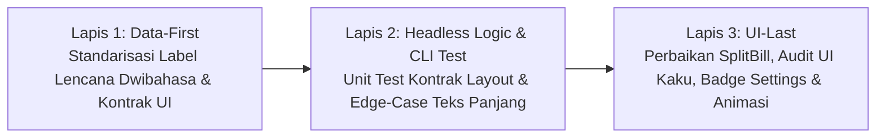

# Rencana Implementasi Fase 4: Solusi Bug Tulisan Vertikal, Audit UI Kaku & Perapian Badge Pengaturan

> [!IMPORTANT]
> **Prinsip Kerja Terkunci:**
> *"Kalau ada bug, cari sumbernya ada di mana lalu perbaiki, setelah itu cek apakah bug masih ada atau tidak, kalau ada perbaiki lagi, setelah itu cek lagi, kalau sudah diperbaiki baru buat laporan, kalau belum diperbaiki diagnosa lagi."*

---

## 1. Analisis Risiko dalam Bahasa Awam (Sebelum Menyentuh Kode)

### A. Dampak ke Fitur Lain
- **Fitur yang Disentuh:**
  1. **Layar Bagi Tagihan ([SplitBillScreen.kt](file:///e:/Antigravity%20Project/FinSmart/app/src/main/java/com/example/ui/screens/SplitBillScreen.kt)):** Mengatur pembagian ruang baris teks pada kartu ringkasan total tagihan, daftar peserta, rincian per orang, daftar item pesanan, dan kartu riwayat struk.
  2. **Kartu Transaksi, Dompet, Anggaran, Aset & Perencana Utang ([TransactionItemRow.kt](file:///e:/Antigravity%20Project/FinSmart/app/src/main/java/com/example/ui/components/TransactionItemRow.kt), [WalletComponents.kt](file:///e:/Antigravity%20Project/FinSmart/app/src/main/java/com/example/ui/components/WalletComponents.kt), [DebtPlannerModalDialog.kt](file:///e:/Antigravity%20Project/FinSmart/app/src/main/java/com/example/ui/components/DebtPlannerModalDialog.kt), [BudgetScreen.kt](file:///e:/Antigravity%20Project/FinSmart/app/src/main/java/com/example/ui/screens/BudgetScreen.kt), [AssetTrackerModalDialog.kt](file:///e:/Antigravity%20Project/FinSmart/app/src/main/java/com/example/ui/components/AssetTrackerModalDialog.kt)):** Mengunci tampilan angka nominal rupiah di sebelah kanan agar tidak pernah terlipat ke bawah.
  3. **Layar Pengaturan ([SettingsScreen.kt](file:///e:/Antigravity%20Project/FinSmart/app/src/main/java/com/example/ui/screens/SettingsScreen.kt)):** Memindahkan lencana status anggota (*Smart Member / Tamu*) dari samping nama pengguna ke bawah nama pengguna agar rapi dan lega.
  4. **Navigasi Utama & Pop-up Dialog ([FinSmartApp.kt](file:///e:/Antigravity%20Project/FinSmart/app/src/main/java/com/example/ui/FinSmartApp.kt), [ChangePasswordDialog.kt](file:///e:/Antigravity%20Project/FinSmart/app/src/main/java/com/example/ui/components/ChangePasswordDialog.kt), [DeleteAccountDialog.kt](file:///e:/Antigravity%20Project/FinSmart/app/src/main/java/com/example/ui/components/DeleteAccountDialog.kt), [InitialMasterSetupDialog.kt](file:///e:/Antigravity%20Project/FinSmart/app/src/main/java/com/example/ui/components/InitialMasterSetupDialog.kt)):** Menambahkan animasi perpindahan halus antar halaman menu dan gulir vertikal (*scroll*) pada jendela pop-up.
- **Apakah Fitur Stabil Lain Terganggu?**
  **Tidak.** Perhitungan matematika bagi tagihan, saldo dompet, database penyimpanan lokal (Room), kamera scan struk (OCR), dan sistem bahasa (Fase 1–3) **sama sekali tidak diubah**. Kita hanya merapikan tata letak pembungkus teks dan jendela dialog.

### B. Potensi Risiko (Analogi Kehidupan Nyata)
- **Mengapa Bug Tulisan Vertikal Bisa Terjadi?**
  Bayangkan sebuah meja kasir yang ditempati dua orang: **Petugas Pencatat Nama Barang** di sebelah kiri dan **Petugas Penulis Harga Rupiah** di sebelah kanan. Sebelumnya, petugas di kiri tidak diberi batas kursi (`weight`), sehingga saat nama tokonya panjang, ia mendorong petugas di kanan sampai terjepit di pojok tembok. Akibatnya, petugas di kanan terpaksa menulis angka harga menurun satu huruf per baris (`R` lalu di bawahnya `p`, lalu `5`, lalu `0`).
- **Potensi Risiko Saat Diperbaiki:**
  Jika kita memberi batas ruang pada teks kiri tanpa memasang tanda pemotong rapi (`...` / *Ellipsis*), nama toko yang sangat panjang bisa bertabrakan atau mendorong tombol hapus di sebelahnya. Selain itu, jika jendela dialog ditambahkan fitur gulir (*scroll*) pada komponen yang sudah memiliki daftar gulir di dalamnya, layar bisa bingung menentukan mana yang digulir.

### C. Rekomendasi Aman
1. **Kunci Kursi Kanan Terlebih Dahulu:** Berikan aturan `maxLines = 1, softWrap = false` pada seluruh teks angka nominal rupiah di sisi kanan (agar angka harga selalu utuh satu baris mendatar), dan berikan `Modifier.weight(1f, fill = false)` disertai pemotong rapi `overflow = TextOverflow.Ellipsis` pada teks judul/nama di sisi kiri.
2. **Susun Vertikal Lencana Anggota:** Di halaman Pengaturan, letakkan lencana *Smart Member* di baris tersendiri tepat di bawah nama pengguna di dalam kolom vertikal (`Column`), sehingga baik nama pengguna yang panjang maupun lencana anggota sama-sama tampil utuh dan proporsional.
3. **Scroll Aman pada Dialog:** Pasang `verticalScroll(rememberScrollState())` khusus pada kolom isi dialog statis yang belum memilikinya, tanpa mengganggu daftar `LazyColumn` yang sudah bisa digulir sendiri.

---

## 2. Urutan Eksekusi 3-Lapis (Data-First -> Headless Logic -> UI-Last)

### Lapis 1 [DATA-FIRST]: Standarisasi Data Label Lencana & Kontrak Tata Letak
- Memastikan teks lencana pengguna di [SettingsScreen.kt](file:///e:/Antigravity%20Project/FinSmart/app/src/main/java/com/example/ui/screens/SettingsScreen.kt) dan `UserRole` mendukung dwibahasa secara konsisten (`AppStrings.t("Tamu", "Guest")` untuk akun tamu dan `role.badgeText` untuk anggota terdaftar) tanpa nilai *hardcode* yang kaku.

### Lapis 2 [HEADLESS LOGIC & CLI TEST]: Pengujian Terminal Otomatis
- Membuat file pengujian baru `app/src/test/java/com/example/Phase4UiResponsivenessAndLayoutContractTest.kt` yang menguji secara otomatis lewat terminal:
  1. **Anti-Vertical-Text Contract di `SplitBillScreen.kt`:** Memastikan seluruh baris ringkasan total tagihan, rincian per orang, daftar pesanan (`SplitBillItemCard`), dan kartu riwayat struk memiliki pasangan `Modifier.weight(1f, fill = false)` di sisi kiri dan `maxLines = 1, softWrap = false` pada teks nominal `CurrencyFormatter.formatRupiah(...)` di sisi kanan.
  2. **Rigid UI Audit Contract:** Memastikan `TransactionItemRow.kt`, `WalletComponents.kt`, `DebtPlannerModalDialog.kt`, `BudgetScreen.kt`, dan `AssetTrackerModalDialog.kt` mengunci teks nominal rupiah dengan `maxLines = 1` dan `softWrap = false`.
  3. **Smart Member Badge Contract di `SettingsScreen.kt`:** Memastikan badge keanggotaan berada di bawah nama pengguna di dalam `Column` (bukan lagi berdesakan di dalam `Row` yang sama dengan `displayedUsername`).
  4. **Smooth Tab Transition & Dialog Scroll Contract:** Memastikan [FinSmartApp.kt](file:///e:/Antigravity%20Project/FinSmart/app/src/main/java/com/example/ui/FinSmartApp.kt) menggunakan `AnimatedContent` untuk perpindahan tab utama dan seluruh dialog form memiliki `verticalScroll(rememberScrollState())`.

### Lapis 3 [UI-LAST / VISUAL HOOK]: Implementasi Antarmuka Nyata
1. **Perbaikan Bug Tulisan Vertikal di [SplitBillScreen.kt](file:///e:/Antigravity%20Project/FinSmart/app/src/main/java/com/example/ui/screens/SplitBillScreen.kt):**
   - **Ringkasan Total Tagihan (baris 359–384):** Tambahkan `modifier = Modifier.weight(1f, fill = false)` pada `Column` nama tempat/tanggal di kiri; tambahkan `maxLines = 1, softWrap = false` pada `Text(CurrencyFormatter.formatRupiah(currentReceiptState.totalAmount))` di kanan.
   - **Header Daftar Peserta & Item Pesanan (baris 396–421 & 485–512):** Tambahkan `modifier = Modifier.weight(1f, fill = false)` pada elemen judul di kiri agar tombol aksi di kanan tidak pernah terhimpit.
   - **Kartu Rincian Per Orang / *Proportional Breakdown* (baris 591–685):**
     - Baris header nama peserta vs Total Bayar: Berikan `Modifier.weight(1f, fill = false)` pada `Row` profil kiri dan `maxLines = 1, softWrap = false` pada label `"Total Bayar:"` serta nominal `CurrencyFormatter.formatRupiah(breakdown.totalToPay)`.
     - Baris item pesanan yang ditugaskan (`${item.qty}x ${item.name}`): Berikan `Modifier.weight(1f, fill = false)` pada teks nama item di kiri dan `maxLines = 1, softWrap = false` pada nominal `CurrencyFormatter.formatRupiah(itemShare)` di kanan.
     - Baris Pajak & Layanan (`Porsi PB1 & Service:`): Berikan `Modifier.weight(1f, fill = false)` di kiri dan `maxLines = 1, softWrap = false` pada nominal pajak di kanan.
   - **Kartu Riwayat Bagi Tagihan (baris 927–950):** Berikan `Modifier.weight(1f, fill = false)` pada `Column` kiri dan `maxLines = 1, softWrap = false` pada `Text(CurrencyFormatter.formatRupiah(item.totalAmount))` di kanan.
   - **Kartu Item Pesanan [`SplitBillItemCard`](file:///e:/Antigravity%20Project/FinSmart/app/src/main/java/com/example/ui/screens/SplitBillScreen.kt#L1372-L1483) (baris 1385–1428):** Ubah `Column` kiri menjadi `Modifier.weight(1f, fill = false)` dengan `maxLines = 1, overflow = TextOverflow.Ellipsis`, dan tambahkan `maxLines = 1, softWrap = false` pada `Text(CurrencyFormatter.formatRupiah(item.total))` di kanan.
   - **Dialog di `SplitBillScreen.kt`:** Tambahkan `.verticalScroll(rememberScrollState())` pada `Column` isi dialog tambah orang, tambah item, edit pajak/diskon, dan konfirmasi hapus.

2. **Audit & Perbaikan UI Kaku di Komponen Lain:**
   - **[TransactionItemRow.kt](file:///e:/Antigravity%20Project/FinSmart/app/src/main/java/com/example/ui/components/TransactionItemRow.kt):** Ubah `Column` kiri menjadi `Modifier.weight(1f, fill = false)` dan tambahkan `softWrap = false` pada teks nominal transaksi serta nama dompet di sisi kanan.
   - **[WalletComponents.kt](file:///e:/Antigravity%20Project/FinSmart/app/src/main/java/com/example/ui/components/WalletComponents.kt):** Tambahkan `Modifier.weight(1f, fill = false)` pada judul `WalletsSection`, kunci baris dompet di `CurrencyAssignmentWizardDialog` dengan `weight(1f, fill = false)` di kiri dan `maxLines = 1, softWrap = false` di kanan, serta lengkapi `verticalScroll(rememberScrollState())` pada dialog dompet.
   - **[DebtPlannerModalDialog.kt](file:///e:/Antigravity%20Project/FinSmart/app/src/main/java/com/example/ui/components/DebtPlannerModalDialog.kt):** Kunci seluruh teks nominal rupiah pada *Summary Banner*, *Budget Comparison Card*, *Monthly Schedule*, *Next Month Schedule*, *Priority Debt Item Card*, dan *Installment Plan Card* dengan `maxLines = 1, softWrap = false` serta `Modifier.weight(1f, fill = false)` di sisi label kiri; tambahkan `verticalScroll` pada dialog input/konfirmasi di dalamnya.
   - **[BudgetScreen.kt](file:///e:/Antigravity%20Project/FinSmart/app/src/main/java/com/example/ui/screens/BudgetScreen.kt) & [AssetTrackerModalDialog.kt](file:///e:/Antigravity%20Project/FinSmart/app/src/main/java/com/example/ui/components/AssetTrackerModalDialog.kt):** Tambahkan `maxLines = 1, softWrap = false` pada teks nominal di sisi kanan dan `verticalScroll` pada dialog form.

3. **Perapian Badge *Smart Member* di [SettingsScreen.kt](file:///e:/Antigravity%20Project/FinSmart/app/src/main/java/com/example/ui/screens/SettingsScreen.kt):**
   - Pada kartu profil pengguna (baris 428–465), pindahkan komponen `Surface` badge (`role.badgeText` / `"Tamu"`) dari samping `displayedUsername` ke **bawah** `displayedUsername` di dalam `Column(modifier = Modifier.weight(1f, fill = false))` dengan `Spacer(modifier = Modifier.height(4.dp))`.
   - Sembunyikan baris email jika pengguna berstatus Tamu (`isGuest == true` atau email kosong) agar kartu profil terlihat seimbang di tengah secara vertikal.

4. **Animasi Transisi Halus Antar Tab & Scroll Dialog di [FinSmartApp.kt](file:///e:/Antigravity%20Project/FinSmart/app/src/main/java/com/example/ui/FinSmartApp.kt):**
   - Bungkus blok navigasi `when (currentScreen)` di `FinSmartApp.kt` menggunakan `AnimatedContent` (`fadeIn(tween(220)) togetherWith fadeOut(tween(180))`) sehingga perpindahan antar menu bawah terasa mulus.
   - Tambahkan `.verticalScroll(rememberScrollState())` pada `Column` utama di [ChangePasswordDialog.kt](file:///e:/Antigravity%20Project/FinSmart/app/src/main/java/com/example/ui/components/ChangePasswordDialog.kt), [DeleteAccountDialog.kt](file:///e:/Antigravity%20Project/FinSmart/app/src/main/java/com/example/ui/components/DeleteAccountDialog.kt), dan [InitialMasterSetupDialog.kt](file:///e:/Antigravity%20Project/FinSmart/app/src/main/java/com/example/ui/components/InitialMasterSetupDialog.kt).

---

## 3. Rencana Verifikasi End-to-End (4 Pilar Bukti)
1. **Eksekusi Unit Test Lengkap:** Menjalankan `./gradlew testDebugUnitTest` hingga seluruh 989+ unit test lama ditambah unit test kontrak Fase 4 lulus **100% PASS**.
2. **Audit Anti-Fake-Pass:** Menjalankan `python auto_sync.py audit` untuk memastikan nol `TODO`, nol `dummy`, dan nol `mock_data`.
3. **Dokumentasi & Sinkronisasi:** Memperbarui `END_TO_END_PROOF.md`, `CURRENT_CHECKPOINT.md`, dan `ROADMAP.md`, lalu menjalankan `python auto_sync.py save`.
