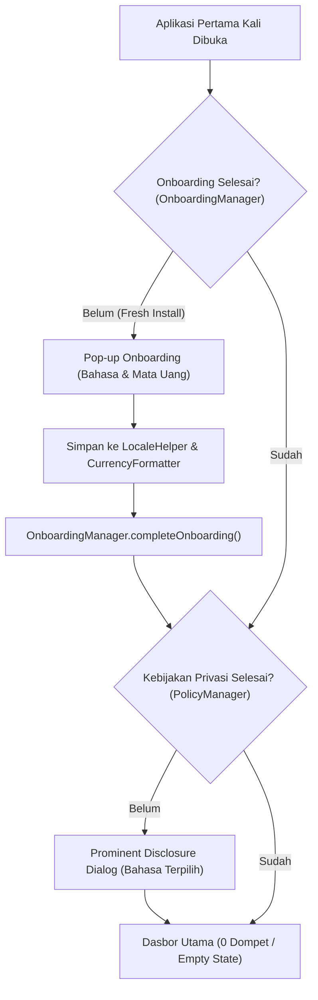

# Rencana Implementasi Fase 2: Pengaturan Awal Instalasi (Nol Dompet & Pop-up Onboarding Bahasa / Mata Uang)

## Ringkasan Tujuan
Tujuan Fase 2 adalah memberikan pengalaman pertama yang bersih, terarah, dan elegan (*first-run experience*) kepada pengguna yang baru pertama kali menginstal DompetNalar:
1. **Nol Dompet Awal (User Autonomy):** Memastikan pada instalasi bersih (akun baru / tamu baru), tidak ada dompet bawaan tiruan yang dibuat otomatis. Ruang dompet berstatus 0 dompet, dan antarmuka Dasbor serta Layar Dompet menampilkan *Empty State* yang ramah dengan tombol "+ Tambah Dompet".
2. **Pop-up Onboarding Pertama Kali Buka (First-Run Setup Dialog):** Membangun pop-up selamat datang yang muncul satu kali saat aplikasi pertama kali dibuka setelah instalasi baru untuk langsung memilih Bahasa Antarmuka (Ikuti Sistem HP, Bahasa Indonesia, English) dan Mata Uang Utama (Ikuti Wilayah HP, IDR, USD, EUR, dsb.) sebelum pengguna memasuki Dasbor.

---

## User Review Required
> [!IMPORTANT]
> **Urutan Alur Pertama Kali Buka (First-Run Sequence):**
> Saat aplikasi dibuka pertama kali setelah penginstalan:
> 1. Tampilan *Startup Loading* selesai.
> 2. **Pop-up Onboarding (Fase 2):** Pengguna menyetel Bahasa Antarmuka dan Mata Uang Utama, lalu menekan **"Simpan & Mulai"**.
> 3. **Pop-up Kebijakan Privasi (Fase C / Prominent Disclosure):** Muncul langsung dalam bahasa yang baru saja dipilih pengguna.
> 4. Pengguna masuk ke **Dasbor Utama** yang berstatus bersih (0 dompet) dengan kartu ajakan ramah "+ Tambah Dompet".

> [!NOTE]
> **Ketahanan Data & Privasi (Zero-Cost FOSS):**
> Status onboarding disimpan secara privat di `SharedPreferences` perangkat (`finsmart_onboarding_prefs`) tanpa mengirim apa pun ke cloud dan tanpa membebani memori database Room.

---

## Open Questions
Tidak ada pertanyaan memblokir saat ini. Rancangan ini 100% kompatibel dengan arsitektur Room v11, `LocaleHelper`, dan `CurrencyFormatter` yang telah diverifikasi di Fase 1.

---

## Proposed Changes



---

### Lapis 1: Data-First (Penyimpanan Status Onboarding)

#### [NEW] `app/src/main/java/com/example/util/OnboardingManager.kt`
- Mengelola status penyelesaian onboarding pengguna baru secara lokal dan ringan di SharedPreferences (`finsmart_onboarding_prefs`).
- Menyediakan fungsi:
  * `isOnboardingCompleted(context: Context): Boolean`
  * `completeOnboarding(context: Context)`
  * `resetForTesting(context: Context)`

```kotlin
package com.example.util

import android.content.Context
import android.content.SharedPreferences

object OnboardingManager {
    const val PREFS_NAME = "finsmart_onboarding_prefs"
    const val KEY_ONBOARDING_COMPLETED = "has_completed_first_run_onboarding"
    const val KEY_ONBOARDING_TIMESTAMP = "onboarding_completed_timestamp"

    private fun getPrefs(context: Context): SharedPreferences {
        return context.applicationContext.getSharedPreferences(PREFS_NAME, Context.MODE_PRIVATE)
    }

    fun isOnboardingCompleted(context: Context): Boolean {
        return getPrefs(context).getBoolean(KEY_ONBOARDING_COMPLETED, false)
    }

    fun completeOnboarding(context: Context) {
        getPrefs(context).edit()
            .putBoolean(KEY_ONBOARDING_COMPLETED, true)
            .putLong(KEY_ONBOARDING_TIMESTAMP, System.currentTimeMillis())
            .apply()
    }

    fun resetForTesting(context: Context) {
        getPrefs(context).edit().clear().apply()
    }
}
```

---

### Lapis 2: Headless Logic & CLI Test

#### [NEW] `app/src/test/java/com/example/Phase2FirstRunOnboardingAndZeroWalletsTest.kt`
- Menguji secara headless di terminal:
  1. `OnboardingManager`: Memastikan status default `false`, berubah menjadi `true` setelah `completeOnboarding()`, dan dapat di-reset untuk pengujian.
  2. Integrasi Pengaturan Bahasa: Pemilihan bahasa pada dialog onboarding memanggil `LocaleHelper.setLanguage` secara valid dan mengubah status `LocaleHelper.isEnglish()`.
  3. Integrasi Pengaturan Mata Uang: Pemilihan mata uang (Follow Device vs Manual IDR/USD/EUR) tersimpan secara akurat ke `CurrencyFormatter`.
  4. Jaminan Nol Dompet Awal: Pengguna baru (guest atau registered) memiliki 0 dompet, dan `provisionDefaultWalletsIfEmpty` terbukti mengembalikan `emptyList()`.

---

### Lapis 3: UI-Last (Tampilan Visual & Integrasi Antarmuka)

#### [NEW] `app/src/main/java/com/example/ui/components/FirstRunOnboardingDialog.kt`
- Dialog pop-up selamat datang yang muncul satu kali saat aplikasi baru diinstal:
  * **Properti Modal:** `DialogProperties(dismissOnBackPress = false, dismissOnClickOutside = false)` agar pengguna menyelesaikan pengaturan awal sebelum masuk.
  * **Responsif:** Dilengkapi `Modifier.verticalScroll(rememberScrollState())` agar tidak terpotong pada layar kecil atau font besar.
  * **Header:** Ikon merek DompetNalar, judul "Selamat Datang di DompetNalar" / "Welcome to DompetNalar", dan instruksi ramah.
  * **Pilihan Bahasa:** Radio/Card interaktif untuk:
    1. *Ikuti Sistem HP* (`AppLanguage.SYSTEM`)
    2. *Bahasa Indonesia* (`AppLanguage.INDONESIAN`)
    3. *English* (`AppLanguage.ENGLISH`)
  * **Pilihan Mata Uang:** Opsi radio & chip interaktif untuk:
    1. *Ikuti Wilayah HP* (`CurrencyMode.FOLLOW_DEVICE`) dengan keterangan mata uang yang terdeteksi.
    2. *Mata Uang Populer:* IDR, USD, EUR, SGD, MYR, dsb. (`CurrencyMode.MANUAL`)
  * **Tombol Aksi:** Tombol utama elegan "Simpan & Mulai" / "Save & Get Started" yang menerapkan preferensi dan menutup dialog.

#### [MODIFY] `app/src/main/java/com/example/ui/components/WalletComponents.kt`
- Memperbarui `WalletsSection`:
  * Jika `wallets.isEmpty()`, tampilkan kartu *Empty State* yang elegan di Dasbor berisi ikon dompet, teks ramah *"Belum Ada Dompet"* beserta deskripsi panduan, dan tombol interaktif **"+ Tambah Dompet"**.

#### [MODIFY] `app/src/main/java/com/example/ui/screens/WalletsScreen.kt`
- Memperbarui tampilan kartu *Empty State* pada Layar Manajemen Dompet agar menyertakan tombol interaktif **"+ Tambah Dompet"** di dalam kartu kosong tersebut.

#### [MODIFY] `app/src/main/java/com/example/ui/FinSmartApp.kt`
- Menghubungkan `isFirstRunOnboardingPending`:
  * Menginisialisasi state dari `!OnboardingManager.isOnboardingCompleted(context)`.
  * Menambahkan `isFirstRunOnboardingPending` ke guard gestur goyang HP `isAnyBlockingModalActive`.
  * Menampilkan `FirstRunOnboardingDialog` saat `isFirstRunOnboardingPending && !isStartupLoading`.
  * Saat selesai, mengubah `isFirstRunOnboardingPending = false`, sehingga alur berpindah ke *Prominent Disclosure* (jika belum disetujui) atau langsung ke Dasbor.

---

## Verification Plan

### Automated Tests
1. **Eksekusi Pengujian Otomatis Fase 2:**
   ```powershell
   ./gradlew testDebugUnitTest --tests "com.example.Phase2FirstRunOnboardingAndZeroWalletsTest"
   ```
2. **Eksekusi Seluruh Suite Unit Test Proyek (Uji Regresi):**
   ```powershell
   ./gradlew testDebugUnitTest
   ```
   *Target: 970+ unit test tetap 100% PASS.*

3. **Audit Detektor Data Tiruan:**
   ```powershell
   python auto_sync.py status
   ```

### Manual Verification
1. **Uji Instalasi Bersih:** Hapus data aplikasi / SharedPreferences, buka aplikasi.
2. **Uji Pop-up Onboarding:**
   - Periksa apakah pop-up selamat datang muncul dengan opsi Bahasa dan Mata Uang.
   - Pilih "English" dan "USD ($)", klik "Save & Get Started".
   - Periksa apakah teks aplikasi dan simbol mata uang langsung berubah menjadi `$`.
3. **Uji Nol Dompet:**
   - Periksa Dasbor dan Layar Dompet: saldo 0, tidak ada kartu bank palsu/bawaan yang muncul tanpa izin pengguna.
   - Periksa apakah kartu Empty State tampil elegan dengan tombol "+ Tambah Dompet".
   - Klik tombol "+ Tambah Dompet" dan pastikan dialog penambahan dompet terbuka normal.
