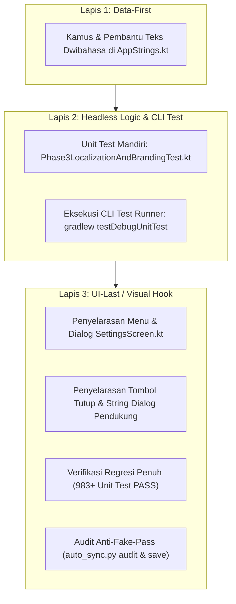

# RENCANA KERJA FASE 3: PENUNTASAN TEKS DWIBAHASA & PEMBERSIHAN MEREK FINSMART

> [!IMPORTANT]
> **PANDUAN PEMILIK PROYEK (NON-CODER OWNER):**
> Dokumen ini adalah peta kerja detail untuk menuntaskan masalah bahasa campur-campur (Indonesia/Inggris) di menu Pengaturan dan dialog, serta merapikan nama merek visual aplikasi menjadi **DompetNalar** seutuhnya.

---

## 🛡️ ANALISIS RISIKO & TABRAKAN FITUR (PROTOKOL 1)

### 1. Dampak ke Fitur Lain
- **File yang disentuh:**
  1. `app/src/main/java/com/example/util/AppStrings.kt` (Kamus penerjemah dwibahasa)
  2. `app/src/main/java/com/example/ui/screens/SettingsScreen.kt` (Layar Pengaturan & dialog pendukung)
  3. `app/src/main/java/com/example/ui/components/WalletComponents.kt` (Komponen dompet & dialog hapus)
  4. `app/src/main/java/com/example/ui/components/DebtPlannerModalDialog.kt` (Dialog perencana hutang)
  5. `app/src/main/java/com/example/ui/components/PayLaterBillReviewDialog.kt` (Review tagihan paylater & OCR)
  6. `app/src/main/java/com/example/ui/components/ExportFormatManagementDialog.kt` (Format ekspor laporan)
- **Keterhubungan:**
  - Fitur yang disentuh murni lapisan presentasi teks (UI strings & visual display).
  - Skema Room Database v11, integrasi Google Play Billing, Cloud Firestore, enkripsi Keystore, dan SharedPreferences teknis **TIDAK DISENTUH SAMA SEKALI** (Zona Merah aman 100%).

### 2. Potensi Risiko (Analogi Awam)
- **Analogi Rumah:**
  Perubahan ini seperti mengganti seluruh papan petunjuk arah, label nama ruangan, dan stiker merek di dalam rumah agar tidak ada tulisan yang tertukar antara bahasa Indonesia dan Inggris.
- **Risiko Potensial:**
  Jika ada tombol aksi (misal tombol *Backup* atau *Restore*) yang secara tidak sengaja tergeser atau logika `onClick`-nya terputus saat merapikan teks, aksi tombol tersebut bisa macet.
- **Pencegahan:**
  Seluruh aksi tombol (`onClick`), pemanggilan ViewModel, dan identitas pengujian (`testTag`) dijaga ketat agar tidak ada satu pun logika pemroses yang berubah.

### 3. Rekomendasi Aman
- Memanfaatkan fungsi resmi terpusat `AppStrings.t("Teks ID", "English Text")` yang otomatis menyelaraskan diri dengan status `LocaleHelper.isEnglish()`.
- Menjaga nama paket internal `com.aistudio.finsmart` dan nama file preferensi teknis (`finsmart_prefs`) agar tidak merusak data lokal pengguna yang sudah terpasang di HP.

---

## 🧱 ALUR KERJA WAJIB 3-LAPIS

### Lapis 1: DATA-FIRST
- Menambahkan atau melengkapi kamus kata kunci di `AppStrings.kt` untuk memastikan frasa umum seperti tombol tutup, status sensor goyang, interval backup, dan opsi delimiter memiliki terjemahan dwibahasa yang baku.

### Lapis 2: HEADLESS LOGIC & CLI TEST
- Membangun berkas pengujian otomatis `app/src/test/java/com/example/Phase3LocalizationAndBrandingTest.kt`.
- Memverifikasi secara headless:
  1. Pengujian `AppStrings.t()` untuk seluruh frasa baru saat mode Indonesia dan Inggris aktif.
  2. Pemformat interval jam (`3j` vs `3h`), opsi goyang HP, dan teks bantuan.
  3. String merek visual `DompetNalar` terbukti konsisten dan tidak ada kebocoran nama lama `FinSmart` di header/dialog.
- CLI test wajib **100% PASS** di terminal sebelum menyentuh file tampilan (Lapis 3).

### Lapis 3: UI-LAST / VISUAL HOOK
1. **Penyelarasan Menu `SettingsScreen.kt`**:
   - Seluruh judul & subjudul: Mode Keuangan, Tema, Warna Aksen, Wallpaper, Dynamic Launcher Icon, Gamifikasi, Tes Profil Finansial AI, Mata Uang, Duress PIN, Aksi Goyang HP, Google Drive & Cloud Sync, Backup Otomatis, Developer Tools.
   - Mengganti seluruh 5+ `Text("Tutup")` menjadi `Text(AppStrings.t("Tutup", "Close"))`.
2. **Penyelarasan Dialog Pendukung**:
   - `WalletComponents.kt`: Placeholder rekening `AppStrings.t("misal: 1234567890", "e.g., 1234567890")`, dialog konfirmasi hapus dompet dwibahasa.
   - `DebtPlannerModalDialog.kt`: Tombol "Tutup", "Coba Lagi", contentDescription "Tutup".
   - `PayLaterBillReviewDialog.kt`: Tombol "Sebelumnya", "Selanjutnya", prefix mata uang dinamis, label tagihan & sisa pokok, tombol "Tutup".
   - `ExportFormatManagementDialog.kt`: Tombol "Tutup", judul dialog edit, label "Nama Format", "Pemisah Nilai", "Format Tanggal", "Sertakan baris header".
3. **Verifikasi Penuh & Audit**:
   - Menjalankan seluruh test debug (`./gradlew testDebugUnitTest`).
   - Memastikan tidak ada fake-pass (`python auto_sync.py audit`).
   - Menyimpan checkpoint via `python auto_sync.py save`.
