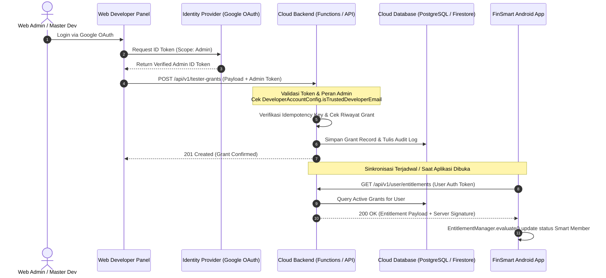

# FINSMART — ARSITEKTUR & PONDASI WEB DEVELOPER PANEL UNTUK HADIAH TESTER

**Dokumen Versi:** 1.0.0  
**Tanggal:** 13 Oktober 2026  
**Status:** Pondasi Desain & Kontrak API (Fase Perencanaan Backend)  
**Tujuan:** Menyediakan landasan arsitektur yang aman, terisolasi, dan terverifikasi untuk Web Developer Panel yang bertugas memberikan reward akses Smart Member kepada tester aplikasi FinSmart.

---

## 1. Ringkasan Eksekutif & Status Infrastruktur Aktual

Aplikasi FinSmart saat ini beroperasi dengan model **Local-First Architecture**:
- **Penyimpanan Lokal:** Basis data SQLite Room versi 8/9 (`FinSmartDatabase`) terenkripsi dengan isolasi multi-user (`userId` scoping).
- **Autentikasi:** Android Credential Manager (Google Sign-In) dan akun lokal PBKDF2-HMAC-SHA256.
- **Pencadangan:** Google Drive REST API v3 terenkripsi AES-GCM-256 (`drive.file` scope).
- **Monetisasi:** Google Play Billing Library v7 dan Google AdMob.
- **Backend Bersama (Shared Cloud Backend):** Saat ini **BELUM TERSEDIA** server aplikasi terpusat (seperti Cloud Functions, Node.js / Go backend, atau database pengguna terpusat). Layanan Firestore yang ada hanya difungsikan untuk pengumpulan laporan umpan balik pengguna (Feedback) dengan aturan `firestore.rules`.

**PENTING:** Web Developer Panel **belum dapat memberikan hadiah langsung ke perangkat secara instan** sebelum backend cloud bersama dan endpoint sinkronisasi entitlement diimplementasikan. Dokumen ini meletakkan pondasi arsitektural yang aman agar pada saat backend dibangun, tidak ada celah keamanan atau konflik bisnis logis.

---

## 2. Prinsip Keamanan Utama (Security Principles)

1. **Zero Secret in Android Binary:**
   - Aplikasi Android FinSmart **TIDAK PERNAH** menyimpan master password, secret administrator, service account key, atau token server.
   - APK Release hanya berisi kunci publik klien (Client ID OAuth, AdMob App ID).
2. **Server-Side Authorization Authority:**
   - Hak pemberian reward **hanya divalidasi di sisi server** oleh identitas administrator terverifikasi (`MASTER_DEV`).
   - Kode Android atau Web UI tidak berhak menentukan apakah suatu reward sah tanpa verifikasi backend bertanda tangan kriptografis (JWT/HMAC).
3. **No Self-Grant Public Endpoint:**
   - Tidak ada endpoint terbuka yang memungkinkan pengguna biasa memanggil API untuk memberikan reward kepada diri mereka sendiri.
4. **Perlindungan Langganan Berbayar (Paid Entitlement Inviolability):**
   - Reward tester **tidak boleh mempersingkat, menimpa, atau mendegradasi** langganan berbayar Google Play Billing yang sudah dimiliki pengguna.
   - Perhitungan kedaluwarsa menerapkan aturan akumulatif/maksimal:
     $$\text{NewExpiry} = \max(\text{CurrentExpiry}, \text{GrantTimestamp} + \text{DurationMillis})$$
5. **Idempotensi & Pencegahan Double Grant:**
   - Setiap transaksi reward wajib menyertakan `idempotencyKey` unik (UUID v4) berbasis hash:
     $$\text{idempotencyKey} = \text{SHA256}(\text{adminId} + \text{targetUserId} + \text{grantDate} + \text{reason})$$

---

## 3. Alur Kerja Arsitektur (End-to-End Workflow)



---

## 4. Skema Data & Kontrak API

### A. Endpoint 1: Pembuatan Hadiah Tester (Admin Only)
- **Metode:** `POST`
- **Jalur:** `/api/v1/admin/tester-grants`
- **Header:**
  - `Authorization: Bearer <ADMIN_OAUTH_TOKEN>`
  - `X-Idempotency-Key: <UUID_V4>`
  - `Content-Type: application/json`

#### Request Payload:
```json
{
  "targetUserEmail": "tester.finansial@gmail.com",
  "targetUserId": "usr_982341",
  "grantType": "TESTER_REWARD_PASS",
  "durationDays": 30,
  "reason": "Top Active Beta Tester - Siklus QA Oktober 2026",
  "campaignId": "BETA_RELEASE_V1.0.3",
  "grantedBy": "lunachroc01@gmail.com"
}
```

#### Response Payload (201 Created):
```json
{
  "status": "SUCCESS",
  "grantId": "grnt_20261013_001",
  "targetUserId": "usr_982341",
  "targetUserEmail": "tester.finansial@gmail.com",
  "grantedRole": "SMART_MASTER",
  "effectiveFrom": "2026-10-13T02:00:00Z",
  "expiresAt": "2026-11-12T02:00:00Z",
  "idempotencyKey": "9f8b2c4e-1234-5678-abcd-ef0123456789",
  "createdAt": "2026-10-13T02:00:00Z"
}
```

### B. Endpoint 2: Sinkronisasi Entitlement Klien Android
- **Metode:** `GET`
- **Jalur:** `/api/v1/user/entitlements`
- **Header:**
  - `Authorization: Bearer <USER_GOOGLE_ID_TOKEN>`

#### Response Payload (200 OK):
```json
{
  "userId": "usr_982341",
  "email": "tester.finansial@gmail.com",
  "entitlements": [
    {
      "source": "DEVELOPER_GRANT",
      "tier": "SMART_MASTER",
      "grantedAt": "2026-10-13T02:00:00Z",
      "expiresAt": "2026-11-12T02:00:00Z",
      "grantReason": "Top Active Beta Tester - Siklus QA Oktober 2026"
    }
  ],
  "effectiveRole": "SMART_MASTER",
  "serverTimestamp": "2026-10-13T02:15:00Z"
}
```

---

## 5. Struktur Audit Log Server (Database Schema)

Tabel/Koleksi `tester_grant_audit_logs`:
| Field | Tipe | Deskripsi |
|---|---|---|
| `audit_id` | String (PK) | Identifier log audit tak terbantahkan |
| `grant_id` | String (FK) | Relasi ke entitas grant |
| `admin_email` | String | Email administrator yang menerbitkan reward |
| `target_email` | String | Email penerima hak akses tester |
| `duration_days` | Integer | Durasi hari yang diberikan (1 s/d 365) |
| `reason` | String | Catatan justifikasi bisnis/QA |
| `ip_address` | String | Alamat IP pemanggil saat request diterbitkan |
| `user_agent` | String | Browser/client identifier admin |
| `created_at` | Timestamp | Waktu pencatatan atomik server |

---

## 6. Rencana Tahapan Implementasi (Next Steps)

1. **Fase 1 (Selesai pada Rilis v1.0.3):**
   - Penyelarasan model `EntitlementManager.kt` di Android (sudah mendukung `DEVELOPER_GRANT`, evaluasi durasi dinamis, dan fallback aman).
   - Pencegahan hardcoding secret di Android APK.
2. **Fase 2 (Penyediaan Backend Terpusat):**
   - Menyiapkan Firebase Cloud Functions atau Cloud Run microservice pada project `finsmart-511117`.
   - Mengonfigurasi Firebase Admin SDK dengan otorisasi terbatas pada admin `lunachroc01@gmail.com`.
3. **Fase 3 (Pembangunan Web Panel Frontend):**
   - Frontend modern (React/Next.js atau Single Page App) dengan Google Identity Services.
   - Dasbor pencarian tester, form pemberian reward dengan validasi input, dan tabel audit log real-time.
4. **Fase 4 (Aktivasi Sinkronisasi Klien):**
   - Menghubungkan Android `AuthViewModel` untuk memanggil endpoint `/api/v1/user/entitlements` saat login Google.
